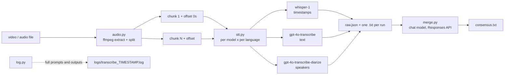

# transcribe-consensus

Transcribe any video or audio file with several OpenAI speech-to-text models at once, then let a
chat model reconcile the outputs into one consensus transcript with timestamps, speaker labels,
and explicit uncertainty markers.

## Why

A single speech-to-text model makes idiosyncratic mistakes, especially on noisy, multi-speaker or
multi-language recordings. Running several models (and the same model with different language
hints) gives independent readings of each utterance. A chat model then does what a human editor
would do with those readings: keep what the models agree on, resolve disagreements from context,
and mark what nobody could hear instead of guessing.

## Methodology

| Phase | Module | What happens |
|---|---|---|
| 1. Audio | `audio.py` | ffmpeg extracts mono 16 kHz 64 kbps mp3. If it exceeds OpenAI's 25 MB upload limit it is split into time segments and each segment's real duration becomes the timestamp offset for later phases. |
| 2. Speech-to-text | `stt.py` | Every requested model is run once per requested language (or once with auto-detect). Parameters are sent only when the model supports them: `whisper-1` returns segment timestamps (`verbose_json`), `gpt-4o-transcribe` / `gpt-4o-mini-transcribe` return text, `gpt-4o-transcribe-diarize` returns speaker-labelled segments (`diarized_json`). |
| 3. Consensus | `merge.py` | All transcripts are sent in one request to a chat model (default `gpt-5`) through the Responses API with fixed, content-agnostic editing rules. The model outputs `[m:ss] SPEAKER: text` lines, marking uncertain words with `[?]` and unintelligible passages with `[~]`. |

The orchestration wrapper in `src/transcribe_consensus/__init__.py` calls these phases in order and
writes every intermediate result so any phase can be inspected or re-run.

## Architecture



## Install

Requirements: Python 3.12+, [uv](https://docs.astral.sh/uv/), [ffmpeg](https://ffmpeg.org/download.html) on `PATH`, an OpenAI API key.

```bash
git clone https://github.com/BurnyCoder/transcribe-consensus.git
cd transcribe-consensus
uv sync
cp .env.example .env   # then put your OPENAI_API_KEY in .env
```

## Use

```bash
# defaults: whisper-1 + gpt-4o-transcribe + gpt-4o-transcribe-diarize, language auto-detect, gpt-5 merge
uv run transcribe.py recording.mp4

# pin languages (each model runs once per language), give the models spelling hints and the merger context
uv run transcribe.py recording.mp4 --languages cs,sk \
    --prompt "Names and jargon that appear: Acme, FooBar" \
    --context "Two engineers discussing a deployment"

# choose models, skip the merge, change output directory
uv run transcribe.py recording.mp4 --models whisper-1,gpt-4o-mini-transcribe --no-merge --out results

# re-run only the merge with a different chat model, reusing the saved raw transcripts
uv run transcribe.py recording.mp4 --from-raw output/recording/raw.json --merge-model gpt-4.1
```

Every flag has a `TRANSCRIBE_*` equivalent in `.env` (see `.env.example`). `--help` lists them.

## What you get

Running on `recording.mp4` produces:

```
output/recording/
  recording.mp3                    # extracted audio (and recording.partNNN.mp3 if split)
  whisper-1.txt                    # one file per model run, e.g. whisper-1[cs].txt when a language is pinned
  gpt-4o-transcribe.txt
  gpt-4o-transcribe-diarize.txt
  raw.json                         # all runs with segments, timestamps, speakers; input for --from-raw
  consensus.txt                    # the merged transcript (printed to the terminal as well)
logs/transcribe_YYYYMMDD_HHMMSS.log  # timestamped log with every request, full prompt and full output
```

Data flow at run time: the log first reports the number of audio chunks, then for each model run
the request parameters, per-chunk character and segment counts and the complete transcript, then the
complete merge instructions and input, and finally the complete merged output.

## Tests

```bash
uv run pytest
```

The tests run offline. The audio phase is exercised on a synthetic sine tone generated by ffmpeg,
and the API-bound code is tested against a fake client that records the parameters it receives.

## Limits and notes

- Costs scale with the number of model runs: `models × languages` transcription calls plus one merge call.
- `gpt-4o-transcribe-diarize` ignores `--prompt` and `--languages` because the API does not accept them for that model; it still runs once per language so the run ids stay distinct.
- Only `whisper-1` and the diarize model return timestamps; if neither is included the merge model has no timing to anchor to.
- A merge model with reasoning (`gpt-5`) follows the uncertainty-marking rules noticeably better than `gpt-4.1` but takes longer.

## Sources

- OpenAI speech-to-text guide: https://platform.openai.com/docs/guides/speech-to-text
- Audio transcription API reference: https://platform.openai.com/docs/api-reference/audio/createTranscription
- Responses API reference: https://platform.openai.com/docs/api-reference/responses/create
- ffmpeg segment muxer: https://ffmpeg.org/ffmpeg-formats.html#segment_002c-stream_005fsegment_002c-ssegment
- openai-python SDK: https://github.com/openai/openai-python

See `AGENTS.md` for a contributor-oriented map of the code and `docs/` for design notes.
