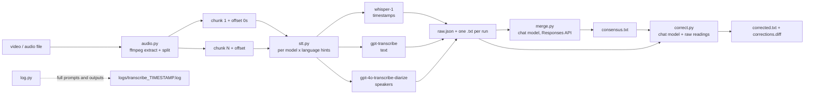

# transcribe-consensus

Transcribe any video or audio file with several OpenAI speech-to-text models at once, let a chat
model reconcile the outputs into one consensus transcript with timestamps, speaker labels and
explicit uncertainty markers, then have a chat model proofread that transcript for words that were
most likely misheard.

## Why

A single speech-to-text model makes idiosyncratic mistakes, especially on noisy, multi-speaker or
multi-language recordings. Running several models (and the same model with different language
hints) gives independent readings of each utterance. A chat model then does what a human editor
would do with those readings: keep what the models agree on, resolve disagreements from context,
and mark what nobody could hear instead of guessing.

## Methodology

| Phase | Module | What happens |
|---|---|---|
| 1. Audio | `audio.py` | ffmpeg extracts mono 16 kHz 64 kbps mp3. If it exceeds OpenAI's 25 MB upload limit it is split into time segments and each segment's real duration becomes the timestamp offset for later phases. |
| 2. Speech-to-text | `stt.py` | Every requested model is run, and parameters are sent only when the model supports them. [`gpt-transcribe`](https://developers.openai.com/api/docs/models/gpt-transcribe), OpenAI's recommended file-transcription model, returns text only. It takes every language hint at once as a `languages` list, so it runs once. `whisper-1` returns segment timestamps (`verbose_json`) and runs once per language hint. `gpt-4o-transcribe-diarize` returns speaker-labelled segments (`diarized_json`) and runs once, because it accepts no language. With no hints, every model runs once with auto-detect. |
| 3. Consensus | `merge.py` | All transcripts are sent in one request to a chat model (default `gpt-6-astra`) through the Responses API with fixed, content-agnostic editing rules. The model outputs `[m:ss] SPEAKER: text` lines, marking uncertain words with `[?]` and unintelligible passages with `[~]`. |
| 4. Correction | `correct.py` | A second request (default `gpt-6-astra`) receives the consensus plus every raw transcript as alternative readings ([N-best-style input](https://arxiv.org/abs/2309.15701)). It fixes words that make no sense in context where a similar-sounding alternative does (misheard words, word boundaries, names, wrong-language recognition in code-switched speech). It must keep lines, timestamps, speakers, fillers and dialect unchanged and mark unsure fixes with `[?]`. Every change is written to `corrections.diff`. |

The orchestration wrapper in `src/transcribe_consensus/__init__.py` calls these phases in order and
writes every intermediate result so any phase can be inspected or re-run.

## Architecture



## Install

Requirements: Python 3.12+, [uv](https://docs.astral.sh/uv/), [ffmpeg](https://ffmpeg.org/download.html) on `PATH`, an OpenAI API key.

```bash
git clone https://github.com/BurnyCoder/transcribe-consensus.git
cd transcribe-consensus
uv sync
cp .env.example .env   # then put your OPENAI_API_KEY in .env
```

## Use

```bash
# defaults: gpt-transcribe + whisper-1 + gpt-4o-transcribe-diarize, language auto-detect,
# gpt-6-astra merge, gpt-6-astra correction
uv run transcribe.py recording.mp4

# hint languages (whisper-1 runs once per language, gpt-transcribe once with all of them),
# give the speech-to-text models spelling hints and the merge/correction models context
uv run transcribe.py recording.mp4 --languages cs,sk \
    --prompt "Names and jargon that appear: Acme, FooBar" \
    --context "Two engineers discussing a deployment"

# choose models, skip the merge and the correction, change output directory
uv run transcribe.py recording.mp4 --models gpt-transcribe,whisper-1 --no-merge --no-correct --out results

# re-run only merge + correction with other chat models, reusing the saved raw transcripts
uv run transcribe.py recording.mp4 --from-raw output/recording/raw.json --merge-model gpt-6.1-sol --correct-model gpt-6.1-sol
```

Every flag has a `TRANSCRIBE_*` equivalent in `.env` (see `.env.example`). `--help` lists them.

## What you get

Running on `recording.mp4` produces:

```
output/recording/
  recording.mp3                    # extracted audio (and recording.partNNN.mp3 if split)
  gpt-transcribe.txt               # one file per model run, e.g. gpt-transcribe[cs,sk].txt, whisper-1[cs].txt with hints
  whisper-1.txt
  gpt-4o-transcribe-diarize.txt
  raw.json                         # all runs with segments, timestamps, speakers; input for --from-raw
  consensus.txt                    # the merged transcript
  corrected.txt                    # the proofread transcript (printed to the terminal as well)
  corrections.diff                 # unified diff consensus.txt -> corrected.txt, one hunk per changed line
logs/transcribe_YYYYMMDD_HHMMSS.log  # timestamped log with every request, full prompt and full output
```

Data flow at run time: the log first reports the number of audio chunks, then for each model run
the request parameters, per-chunk character and segment counts and the complete transcript, then the
complete merge instructions, input and output, and finally the complete correction instructions,
input and output.

## Tests

```bash
uv run pytest
```

The tests run offline. The audio phase is exercised on a synthetic sine tone generated by ffmpeg,
and the API-bound code is tested against a fake client that records the parameters it receives.

## Limits and notes

- Costs scale with the number of model runs: one transcription call per run (single-language models × language hints, everything else once) plus one merge and one correction call.
- `gpt-4o-transcribe-diarize` ignores `--prompt` and `--languages` because the API does not accept them for that model.
- Only `whisper-1` and the diarize model return timestamps, and only the diarize model returns speakers. `gpt-transcribe` returns neither ([model page](https://developers.openai.com/api/docs/models/gpt-transcribe)), so if it runs alone the merge has no timing or speakers to anchor to.
- Every model except `gpt-transcribe` is [deprecated with shutdown on 2027-02-26](https://developers.openai.com/api/docs/deprecations#2026-08-26-transcription-models). The deprecation page names no replacement that returns timestamps or speaker labels, so after that date the pipeline will produce text without them.
- The correction step can still change a correct word. Review `corrections.diff`, and treat fixes marked `[?]` as guesses.

## Sources

- OpenAI speech-to-text guide: https://developers.openai.com/api/docs/guides/speech-to-text
- `gpt-transcribe` model page: https://developers.openai.com/api/docs/models/gpt-transcribe
- `gpt-6-astra` model page: https://developers.openai.com/api/docs/models/gpt-6-astra
- Transcription model deprecations: https://developers.openai.com/api/docs/deprecations#2026-08-26-transcription-models
- Audio transcription API reference: https://platform.openai.com/docs/api-reference/audio/createTranscription
- LLM ASR error correction from N-best hypotheses: Chen et al., HyPoradise (NeurIPS 2023), https://arxiv.org/abs/2309.15701; Ma et al., Can Generative LLMs Perform ASR Error Correction?, https://arxiv.org/abs/2307.04172
- Responses API reference: https://platform.openai.com/docs/api-reference/responses/create
- ffmpeg segment muxer: https://ffmpeg.org/ffmpeg-formats.html#segment_002c-stream_005fsegment_002c-ssegment
- openai-python SDK: https://github.com/openai/openai-python

See `AGENTS.md` for a contributor-oriented map of the code and `docs/` for design notes.
